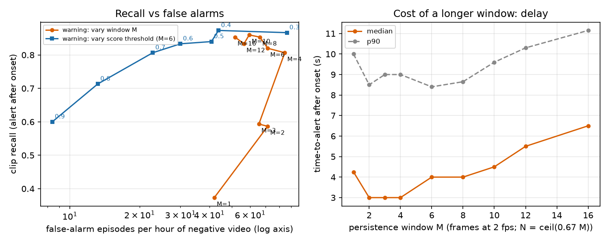
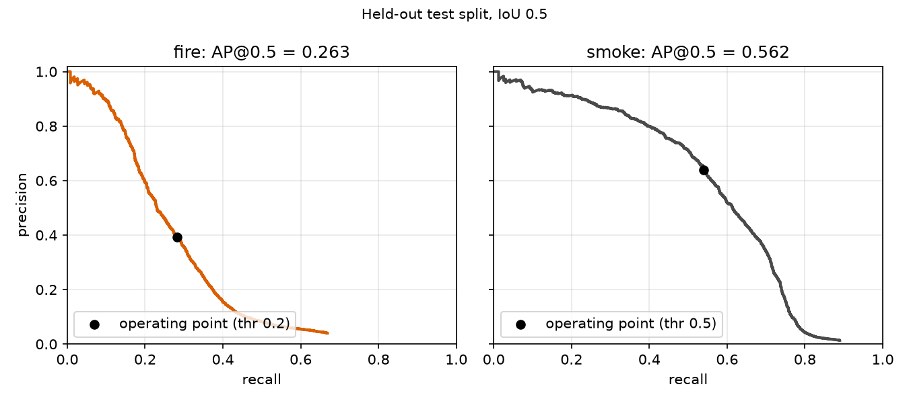

# Results

All numbers come from `runs/*.json` written by `emberwatch eval` / `render`; nothing here is typed by hand.

## Detector (held-out D-Fire test split)

Test images: 4306. Model: SSDlite320 MobileNetV3-Large, COCO-pretrained, fine-tuned 5313 steps (batch 16, 35 min on mps). Thresholds were chosen per class on a 5% validation carve-out of the train split (max box-level F1), never on test.

| class | AP@0.5 | threshold | precision | recall | GT boxes |
|---|---|---|---|---|---|
| fire | 0.263 | 0.2 | 0.392 | 0.282 | 2878 |
| smoke | 0.562 | 0.5 | 0.640 | 0.540 | 2311 |
| mean | 0.413 | | | | |

## False alarms on negative test images (image level)

An image is a false alarm if any detection exceeds its class threshold. D-Fire has no scene tags, so hard negatives are mined from the negatives by colour statistics (see README, limitations).

| subset | images | false-alarm images | rate |
|---|---|---|---|
| all negatives | 2005 | 706 | 0.352 |
| fire-coloured (top 15% orange/red) | 300 | 162 | 0.540 |
| hazy / low-contrast (bottom 15%) | 300 | 112 | 0.373 |

Image-level recall on images that contain fire or smoke: 0.731.

## Temporal logic on synthetic clips

Clips: 150 pos, 120 neg, 40 neg_fire_coloured, 40 neg_hazy. 60 frames at 2 fps of simulated time (onset at frame 10, growth ramp 20 frames). Negative footage total: 1.67 h. Default persistence: 4 of 6 frames.

| system | recall | false-alarm episodes / h | median time-to-alert (s) |
|---|---|---|---|
| frame level (any detection alarms) | 0.967 | 2456 frames/h (0.341 of negative frames) | 0.5 |
| temporal, level >= watch | 0.813 | 103.2 | 3.5 |
| temporal, level >= warning | 0.807 | 75.0 | 3.5 |
| temporal, level >= alarm | 0.440 | 26.4 | 5.5 |
| temporal, warning, growth check off | 0.373 | 51.6 | 5.0 |

Fraction of negative clips with at least one frame-level false alarm: 0.505.

False-alarm episodes per hour at the warning level, by negative subset:

| subset | episodes / h |
|---|---|
| neg | 70.0 |
| neg_fire_coloured | 132.0 |
| neg_hazy | 33.0 |

### Persistence window sweep (warning level)

| M | N | recall | false-alarm episodes / h | median time-to-alert (s) | p90 (s) |
|---|---|---|---|---|---|
| 1 | 1 | 0.373 | 42.0 | 4.2 | 10.0 |
| 2 | 2 | 0.587 | 71.4 | 3.0 | 8.5 |
| 3 | 3 | 0.593 | 65.4 | 3.0 | 9.0 |
| 4 | 3 | 0.807 | 84.6 | 3.0 | 9.0 |
| 6 | 5 | 0.820 | 71.4 | 4.0 | 8.4 |
| 8 | 6 | 0.853 | 66.0 | 4.0 | 8.6 |
| 10 | 7 | 0.860 | 59.4 | 4.5 | 9.6 |
| 12 | 9 | 0.833 | 56.4 | 5.5 | 10.3 |
| 16 | 11 | 0.853 | 51.6 | 6.5 | 11.1 |

### Score-threshold sweep (warning level, M=6, N=4)

| threshold (both classes) | recall | false-alarm episodes / h | median time-to-alert (s) |
|---|---|---|---|
| 0.3 | 0.867 | 86.4 | 3.0 |
| 0.4 | 0.873 | 43.8 | 3.5 |
| 0.5 | 0.840 | 40.8 | 3.5 |
| 0.6 | 0.833 | 30.0 | 4.0 |
| 0.7 | 0.807 | 22.8 | 4.0 |
| 0.8 | 0.713 | 13.2 | 4.5 |
| 0.9 | 0.600 | 8.4 | 5.5 |

## Real-time throughput

`emberwatch watch` on a 960x540 25 fps file, device `mps`, batch 1, 300 frames, 4 torch threads (shared 16 GB M1 Pro):

- end-to-end (decode, resize, inference, alert logic): 42.0 fps
- detector latency: mean 23.3 ms, p95 25.9 ms
